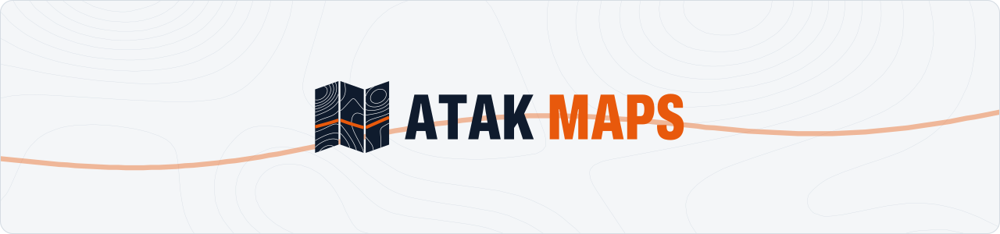
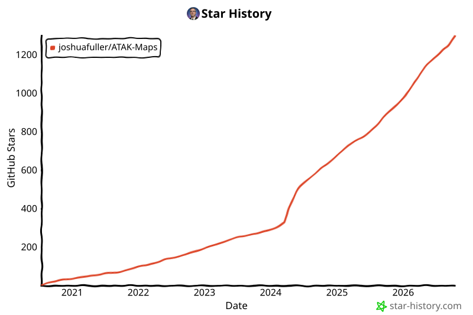

<!-- markdownlint-disable MD041 -- the banner picture comes before the first heading -->

<picture>
  <source media="(prefers-color-scheme: dark)" srcset="docs/assets/brand/readme-banner-dark.svg">
  
</picture>

**Satellite, topo, street, nautical and overlay maps for [ATAK](https://tak.gov). Each one is tested the way ATAK loads tiles.**

### [Open the map explorer →](https://joshuafuller.github.io/ATAK-Maps/maps/)

<table>
<tr>
<td width="50%" valign="top">

### Install maps

- **All maps:** scan this code with your ATAK device.
- **One map:** open the [map explorer](https://joshuafuller.github.io/ATAK-Maps/maps/) on the device and tap **Add to ATAK**.
- **Offline or many devices:** download `atak-maps.zip` from [Releases](https://github.com/joshuafuller/ATAK-Maps/releases/latest).

Problems? See [Install & fix](https://joshuafuller.github.io/ATAK-Maps/install-guide/).

</td>
<td width="50%" valign="top">

### Add or fix a map

- [Add a map](https://joshuafuller.github.io/ATAK-Maps/creating-custom-maps/): naming rules and the XML format.
- Test it the way ATAK loads it: `uv run python -m mapvalidator --harness . --only maps/base/<source>/<map>.xml`
- [Report a broken map](https://github.com/joshuafuller/ATAK-Maps/issues/new)

ATAK 5.1 or later. Not affiliated with TAK.GOV.

</td>
</tr>
</table>

## Maps

<!-- MAP_CATALOG_START -->

| Type | Maps |
|------|------|
| Satellite | Bing Hybrid · Bing Satellite · Esri Clarity · Google Hybrid · Google Hybrid No POI · Google Satellite · NAIP Imagery · PL Ortho · USGS Imagery · USGS Imagery Topo |
| Topographic | CA Toporama · DE Basemap Elevation · DE Basemap Hillshade · Esri Topo · Esri USA Topo · Google Relief · Google Terrain · OpenTopoMap · UK OS Outdoor · USGS Relief · USGS Topo |
| Street | Bing Road · CA Base Map · DE Basemap Color · DE Basemap Gray · Esri NatGeo · Google Road · Google Road Alt · Google Road No POI · UK OS Light · UK OS Road |
| Nautical | + OpenSeaMap · OpenSeaMap Base |
| Cycling | + Google Bike · + Waymarked Cycling · CyclOSM · MTBMap Europe |
| Land use | BLM Land Ownership · BLM Sat + Ownership |
| Overlays | + BLM Public Lands · + CA BC Wildfire · + FEMA Flood · + Google Roads · + Google Transit · + OpenRailwayMap · + ORM Electrified · + ORM Max Speed · + ORM Signals · + USGS Hydro |
| Aeronautical | FAA IFR High · FAA IFR Low · FAA VFR Sectional · FAA VFR Terminal |

Preview every map live, with filters and its current status, in the [map explorer](https://joshuafuller.github.io/ATAK-Maps/maps/).

<!-- MAP_CATALOG_END -->

## Contributing

Contributions are welcome. Start with [Add a map](https://joshuafuller.github.io/ATAK-Maps/creating-custom-maps/) and the [contribution guidelines](CONTRIBUTING.md). Releases are automatic: see the [release guide](docs/release-guide.md).

Questions and ideas: [Discord](https://discord.gg/dQUYADMW87) or [Issues](https://github.com/joshuafuller/ATAK-Maps/issues).

## License

ATAK Maps is distributed under the [MIT License](LICENSE). Each map's tiles belong to its provider; see the source credit in the map explorer.

## Stargazers over time

<!-- star-history:start -->
<picture>
  <source media="(prefers-color-scheme: dark)" srcset="docs/images/star-history/star-history-dark.svg">
  
</picture>
<!-- star-history:end -->
