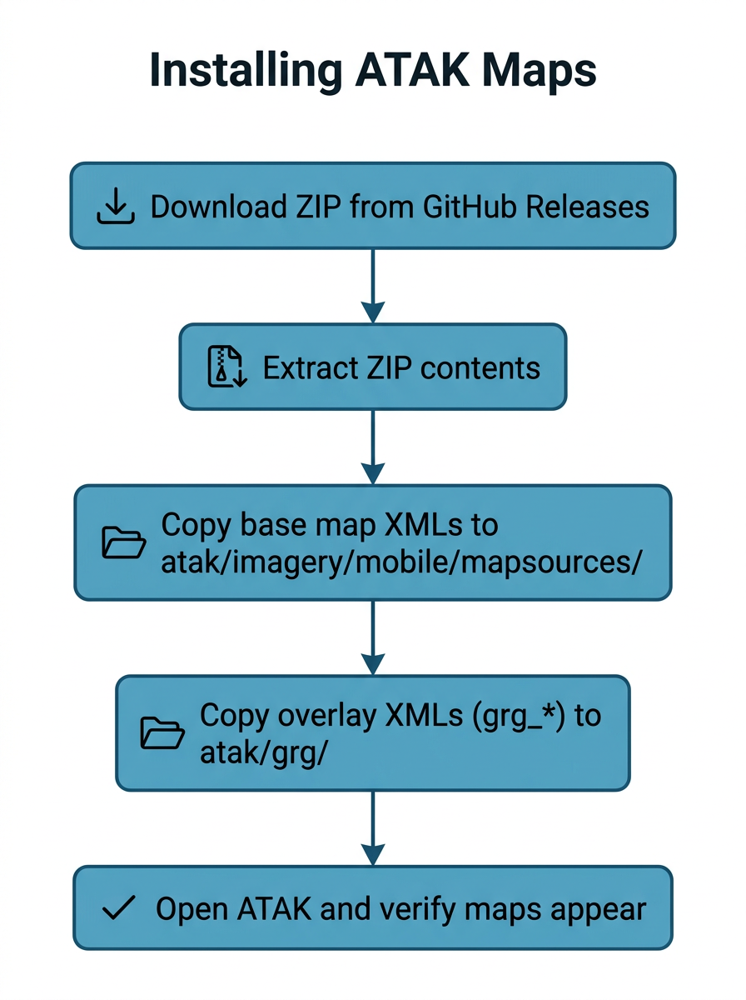
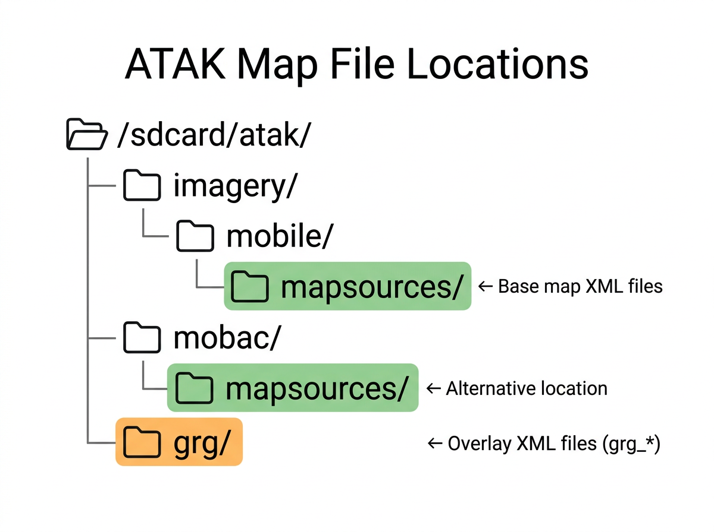

# Installing ATAK Maps

## Quick Start

1. Download `atak-maps.zip` from the [Releases page](https://github.com/joshuafuller/ATAK-Maps/releases).
2. Open the ZIP in ATAK using **Import** — ATAK places the map files automatically.
3. New map sources appear in the map layer selector.

That's it. ATAK's Import feature handles file placement for you.



## Using ATAK Import (Recommended)

The easiest way to install maps is through ATAK's built-in Import feature:

1. Download `atak-maps.zip` from the [Releases page](https://github.com/joshuafuller/ATAK-Maps/releases) onto your device.
2. In ATAK, tap **Import** (or use your file manager to open the ZIP with ATAK).
3. ATAK ingests the ZIP and the map sources populate automatically.
4. Check the map layer selector — new sources should be listed.

For transparent overlays, check their placement using the [Map Tips](#map-tips) below.

## What's in the Download

The release ZIP contains all available XML map source files, organized by provider:

- **Providers included:** Bing, Google, ESRI, USGS, OpenTopo, and others
- **Two types of files:**
  - **Base maps** — satellite imagery, street maps, topographic maps
  - **Overlays** — transparent layers (flood zones, trails, seamarks, reference grids); filenames start with `grg_` and names start with `+`

## Manual Installation (Alternative)

If you prefer to place files manually or want to install only specific maps:



### Base Maps

Copy base-map `.xml` files to:

```text
<storage>/atak/imagery/mobile/mapsources/
```

`<storage>` is your device's internal storage root (typically `/sdcard` or `/storage/emulated/0`). The alternate directory `<storage>/atak/mobac/mapsources/` also works.

### Overlays

Copy overlay XML files (the `grg_` files in `GRG/`) to:

```text
<storage>/atak/grg/
```

These appear as overlay layers in ATAK, not base maps. The `grg_` prefix is a naming convention; the destination directory determines their use as overlays.

### Verify

1. Open ATAK.
2. Tap the map layer selector (layers icon).
3. New map sources should be listed. Select one and confirm tiles load.
4. For overlays, check the overlay manager.

ATAK uses file system monitoring, so new map files may appear without restarting the app. If they don't show up, restart ATAK.

## Installing Individual Maps

You don't have to install the entire collection:

1. Browse the repository folders on [GitHub](https://github.com/joshuafuller/ATAK-Maps).
2. Download just the `.xml` files you want.
3. Either import them via ATAK, or manually place them in the directories above.

## Map Tips

### Base Maps and GRG Overlays

Place base-map XML files in `<storage>/atak/imagery/mobile/mapsources/` and
transparent overlay XML files in `<storage>/atak/grg/`. Select your base map,
then use **Overlay Manager** to turn individual GRG overlays on or off.
If an overlay appears only as a base-map choice after import, move its XML to
`atak/grg/` and restart ATAK.

### Adjusting Imagery Scaling

If symbols or labels on a raster map or GRG overlay appear too small, adjust
**Overlay Manager → Map Controls → Map Imagery Scaling**. This changes imagery
scaling for the base map as well as raster overlays; it is not a separate
seamark-symbol size control. Available controls can vary by ATAK version.

### Using OpenSeaMap

OpenSeaMap has two separate XML sources:

| Source | Install location | Purpose |
|--------|------------------|---------|
| `openseamap/openseamap_base.xml` | `<storage>/atak/imagery/mobile/mapsources/` | Base map |
| `GRG/grg_openseamap.xml` | `<storage>/atak/grg/` | Transparent seamarks overlay |

Select **OpenSeaMap Base** (or any base map), then enable **+ OpenSeaMap** in
Overlay Manager. You can toggle seamarks independently or display them over
another base map. For small symbols, use the imagery-scaling control described
above.

## Offline Caching

ATAK automatically caches map tiles you view. To proactively cache an area for offline use:

1. In ATAK, open the map layer selector and choose the map source you want to cache.
2. Navigate to **Map Manager** (or long-press on the map layer).
3. Select **Download** and draw a region on the map.
4. Choose the zoom levels you need and start the download.
5. Cached tiles are stored in SQLite databases on your device and persist when you go offline.

Once cached, those tiles are available with no internet connection.

## Troubleshooting

### Maps don't appear after import

- Try restarting ATAK.
- If using manual install, confirm files are in the correct directory.
- Check ATAK logs (Settings > Show Log) for errors loading map sources.

### Tiles show as black or blank

- The map server may be down or blocking requests.
- Check your internet connection.
- Some sources (notably OpenStreetMap) may restrict access from ATAK. These files are included for reference but may not always work.

### Wrong directory (manual install)

| File type | Correct directory | Common mistake |
|-----------|-------------------|----------------|
| Base maps (`.xml`) | `atak/imagery/mobile/mapsources/` | `atak/imagery/` (parent dir — won't be scanned) |
| Overlay XMLs (including seamarks) | `atak/grg/` | `atak/imagery/mobile/mapsources/` |

### Accepted file extensions

| Extension | Description |
|-----------|-------------|
| `.xml` | Standard map source (this is what ATAK-Maps provides) |
| `.xmle` | Encrypted XML map source |
| `.bsh` | BeanShell scripted map source |
