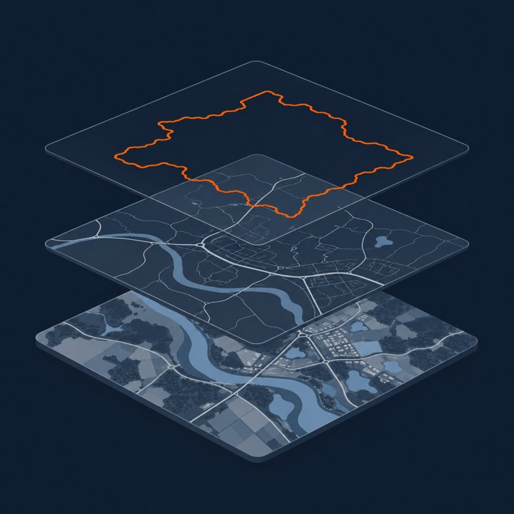
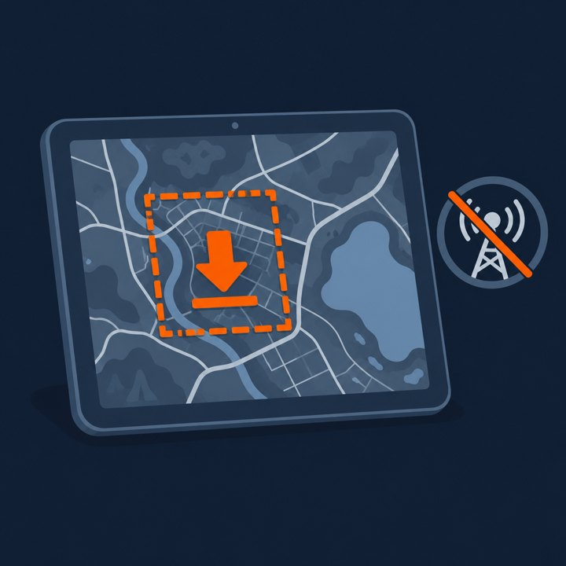
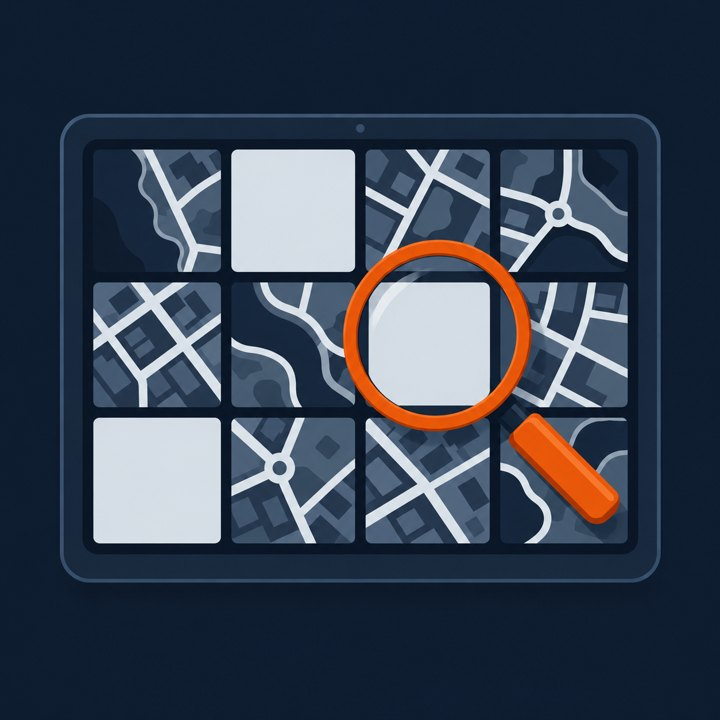

ATAK 5.1 or later

# Install & fix

Get maps into ATAK in under a minute, use them offline, and fix the problems people hit most.

## Pick a way

  <a class="am-card am-card--accent" href="#one-tap-or-qr">Fastest · 1 minOne tap or QR
On the device, or scan from a computer.
</a>
  <a class="am-card" href="#manual-install">Control · 5 minManual copy
Pick exact files. Needed for overlays on top.
</a>
  <a class="am-card" href="#update-or-remove">Many devicesRelease ZIP
One file to hand out or side-load.
</a>

## One tap or QR

  

    <h3>On the ATAK device</h3>
    <ol>
      <li>Open the <a href="../maps/">map explorer</a> in the device's browser.</li>
      <li>Pick a map, then tap <b>Add to ATAK</b>.</li>
      <li>ATAK opens and imports it. It shows in the map layer list.</li>
    </ol>
  

  

    <h3>From a computer</h3>
    

      
      Scan a map's QR code with the device camera. This one adds <b>every map</b> as one data package.
    

  

!!! note "Good to know"
    One-tap import puts every map, overlays too, in the base map list. To draw a “+” overlay on top of another map, use [manual copy](#use-overlays).

## Manual install

Download single XML files from the [map explorer](../maps/), or `atak-maps.zip` from [Releases](https://github.com/joshuafuller/ATAK-Maps/releases/latest). Copy them to the device:

| File | Copy to |
|------|---------|
| Base maps | `atak/imagery/mobile/mapsources/` |
| “+” overlays | `atak/grg/` |

`atak/` is in the device's internal storage, usually `/sdcard` or `/storage/emulated/0`. `atak/mobac/mapsources/` also works for base maps. New files usually show at once; if not, restart ATAK.

## Use overlays

{ alt="" }

1. Copy the “+” map's XML to `atak/grg/`.
2. Pick any base map in ATAK.
3. Turn the overlay on in **Overlay Manager**.

Symbols too small? **Overlay Manager → Map Controls → Map Imagery Scaling**. Try overlays first in the [map explorer](../maps/?tab=overlays).

## Offline use

{ alt="" }

ATAK keeps the tiles you view. To save an area before you lose signal:

1. Select the map in the map layer selector.
2. Open **Map Manager** and choose **Download**.
3. Draw the area and pick the zoom levels.

The [map explorer](../maps/) shows an estimate for the area on screen, for example “1,240 tiles · about 25 MB”.

## Update or remove

  
<h3>Update</h3>
Import the new package or ZIP again. It replaces the old files.

  
<h3>Remove</h3>
Delete the package in the <b>Mission Package Tool</b>, or delete the XML files you copied.

  
<h3>Coming from v1?</h3>
v2 renamed every map. ATAK keeps offline tiles under the old names, so download your areas again.

## Fix a problem

{ alt="" }

??? question "Map is blank or black"
    - **Outside its region:** US, UK, DE, CA and PL maps only draw inside that country.
    - **Zoomed too far:** each map stops at its own deepest zoom.
    - **Server down:** check the map's status in the [map explorer](../maps/). Every map is tested weekly the way ATAK loads it.

??? question "Maps do not show after import"
    Restart ATAK. For manual installs, check the folder: base maps are not read from `atak/imagery/` itself. ATAK's log is under **Settings → Show Log**.

??? question "Overlay replaces my map"
    It was imported as a base map. Move its XML to `atak/grg/` and restart ATAK.

??? question "UK OS map needs a key"
    Get a free key from the OS Data Hub, open the XML, and replace `API_KEY_HERE` with it.

??? question "Where is OpenStreetMap?"
    The main OpenStreetMap tile servers block ATAK, so we do not include them. OSM-based maps from other servers (OpenTopoMap, CyclOSM, OpenSeaMap) work.

??? question "Which file types does ATAK read?"
    `.xml` map sources (what ATAK Maps provides), `.xmle` encrypted map sources and `.bsh` scripted map sources.

Still stuck? [Report a broken map](https://github.com/joshuafuller/ATAK-Maps/issues/new) or ask in [Discord](https://discord.gg/dQUYADMW87).
